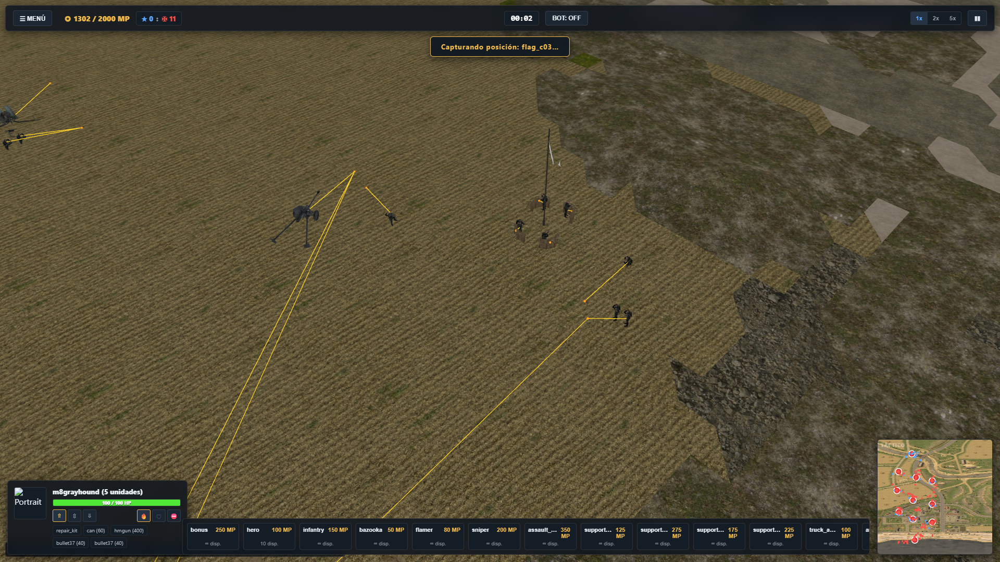
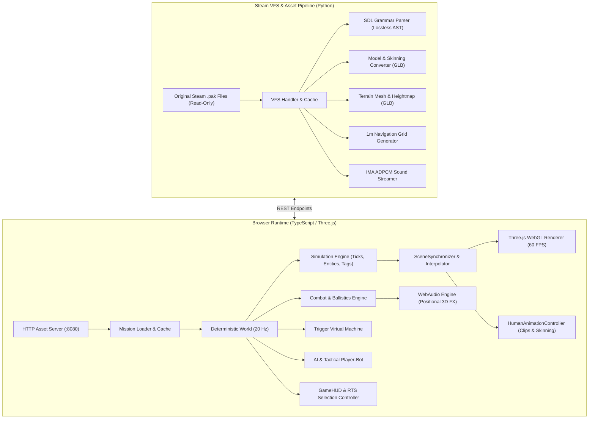
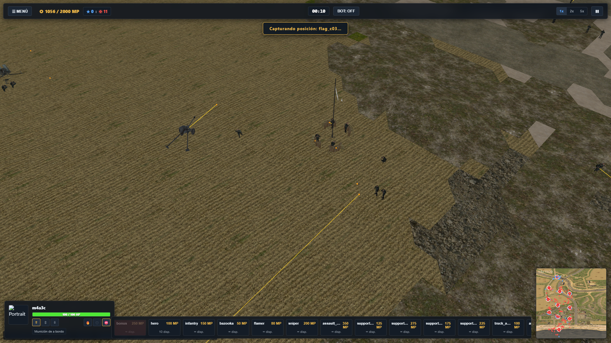
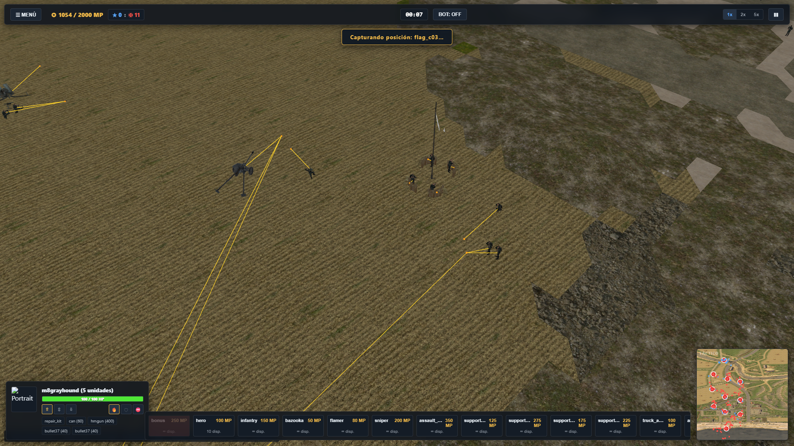

# OpenMoW-Web 🎮⚔️

> **High-Performance WebGL & TypeScript Engine Port of *Men of War: Assault Squad 2***  
> Pure browser RTS simulation running at 60 FPS with deterministic 20 Hz simulation, skeletal animation skinning, authentic ballistics, and 15 skirmish campaigns across 5 WWII factions.



---

## 🌟 Overview

**OpenMoW-Web** is an autonomous reverse-engineering and recreation of Digitalmindsoft's **GEM2 Engine** (*Men of War: Assault Squad 2*). It delivers desktop-grade RTS mechanics directly inside modern web browsers using **TypeScript**, **Three.js**, **WebAudio**, and a multi-threaded Python asset translation server reading directly from original Steam `.pak` files in read-only mode.

### Key Capabilities
- 🕹️ **Pure Web RTS**: Zero browser plugins, 100% standard WebGL and WebAudio.
- 🎯 **Deterministic 20 Hz Simulation**: Bit-level state reproducibility validated with 64-bit FNV-1a hashes across 5-minute simulations (6,000 ticks).
- 🚶 **Skeletal Mesh Skinning**: Full bone hierarchy bindings (`EPLYBNDS`) playing native `.eanm` clips (`idle`, `walk`, `run`, `crouch`, `prone`, `shoot`, `die`) via Three.js `AnimationMixer` with automated kinematic IK track filtering.
- 💥 **Authentic GEM2 Ballistics**: Armor penetration curves ($R \le R_{\max}$), angular ricochets ($\theta \ge 70^\circ$), health damage degradation, and multi-component hit evaluation (hull front/side/rear and turret armor).
- 🗺️ **1m Navigation Grid & A* Pathfinding**: Sub-2.5 ms average queries, vehicle turn radius kinetics, and obstacle avoidance.
- 📜 **Complete GEM2 Trigger Virtual Machine**: Event bus, condition terms (`event`, `cmp_i`, `entities`, `difficulty`), coroutine delays, and full trigger resolution across all 15 official skirmish missions with zero unknown actions.
- 📻 **Reinforcement Economy & HUD**: 20 deployable squads and armored combat vehicles, real-time command points (MP), cooldown sweeps, tactical minimap radar, and audio via IMA ADPCM (Format 0x0011).

---

## 🚀 Quick Start

### Prerequisites
- **Python 3.10+** (with standard libraries: `http.server`, `socketserver`)
- **Node.js 18+** & `npm`
- Installed copy of *Men of War: Assault Squad 2* on Steam (detected automatically at default library paths)

### 1. Launch Local Asset Server
```powershell
# From the project root
.\run.ps1
```
Or directly via Python:
```powershell
python tools\server\main.py --port 8080
```

### 2. Open Game in Browser
Navigate to:
👉 **`http://127.0.0.1:8080/`**

---

## 🗺️ Skirmish Campaign Matrix

OpenMoW-Web includes full mission support, terrain geometry, navigation grids, and triggers for all 15 official skirmishes:

| Faction | Mission 1 | Mission 2 | Mission 3 |
| :--- | :--- | :--- | :--- |
| **🇺🇸 United States (USA)** | [Overlord](http://127.0.0.1:8080/?m=map/single/01_usa-skirmish/01_usa-overlord&autoplay=1) | [Carentan](http://127.0.0.1:8080/?m=map/single/01_usa-skirmish/02_usa-carentan&autoplay=1) | [Ardennes](http://127.0.0.1:8080/?m=map/single/01_usa-skirmish/03_usa-ardennes&autoplay=1) |
| **🇩🇪 Germany (GER)** | [Caen](http://127.0.0.1:8080/?m=map/single/02_ger-skirmish/01_ger-caen&autoplay=1) | [Saint-Hilaire](http://127.0.0.1:8080/?m=map/single/02_ger-skirmish/02_ger-sthilaire&autoplay=1) | [Market Garden](http://127.0.0.1:8080/?m=map/single/02_ger-skirmish/03_ger-marketgarden&autoplay=1) |
| **🇬🇧 Commonwealth (ENG)** | [Battleaxe](http://127.0.0.1:8080/?m=map/single/03_eng-skirmish/01_eng-battleaxe&autoplay=1) | [Torch](http://127.0.0.1:8080/?m=map/single/03_eng-skirmish/02_eng-torch&autoplay=1) | [Arnhem](http://127.0.0.1:8080/?m=map/single/03_eng-skirmish/03_eng-arnhem&autoplay=1) |
| **🇷🇺 Soviet Union (RUS)** | [Smolensk](http://127.0.0.1:8080/?m=map/single/04_rus-skirmish/01_rus-smolensk&autoplay=1) | [Königsberg](http://127.0.0.1:8080/?m=map/single/04_rus-skirmish/02_rus-koenigsberg&autoplay=1) | [Manchuria](http://127.0.0.1:8080/?m=map/single/04_rus-skirmish/03_rus-manchuria&autoplay=1) |
| **🇯🇵 Imperial Japan (JAP)** | [Khalkhin Gol](http://127.0.0.1:8080/?m=map/single/05_jap-skirmish/01_jap-khalkhingol&autoplay=1) | [Singapore](http://127.0.0.1:8080/?m=map/single/05_jap-skirmish/02_jap-singapore&autoplay=1) | [Iwo Jima](http://127.0.0.1:8080/?m=map/single/05_jap-skirmish/03_jap-iwojima&autoplay=1) |

---

## 🏗️ Architecture



---

## 🧪 Verification & Test Suite

The engine is covered by an automated test suite executed with **Vitest**:

```bash
cd web
npm test
```

### Test Results Summary (100% Passing)
- **`test/combat.test.ts`**: 6/6 tests passing (M1 Garand damage, 88mm KwK36 vs Sherman, 75mm bounce vs Tiger, 70° ricochet limit, deterministic state hash).
- **`test/skinning.test.ts`**: 3/3 tests passing (EPLYBNDS skinning binding, 7 core animation clips, track filtering).
- **`test/rts_control.test.ts`**: 4/4 tests passing (Squad selection, waypoint navigation, posture transitions).
- **`test/skirmish.test.ts`**: 5/5 tests passing (Economy, purchases, flag captures, win/loss matrix on 15 skirmishes).
- **`test/ui.test.ts`**: 11/11 tests passing (DOM clicks, selection inspector, reinforcements, minimap radar).
- **`test/vm.test.ts`**: 6/6 tests passing (267 triggers evaluated with 0 unknown terms and actions).
- **`test/nav.test.ts`**: 6/6 tests passing (1,000 A* queries with average time < 2.3 ms, obstacle clearance).
- **`test/audio.test.ts`**: 8/8 tests passing (IMA ADPCM 0x0011 decoder, zero decoder errors across all factions).
- **`test/engine_sim.test.ts`**: 2/2 tests passing (6,000 ticks / 5 minutes headless simulation with bit-level hash determinism: `b578bfd2` and `caf0e0d4`).

---

## 🎮 Gameplay Controls

| Action | Control |
| :--- | :--- |
| **Pan Camera** | `W` / `A` / `S` / `D` or Screen Edge Scroll |
| **Rotate Camera** | Middle Mouse Drag or `Q` / `E` |
| **Zoom Camera** | Mouse Wheel |
| **Select Troops** | Left Click or Drag Marquee Box |
| **Issue Move / Attack** | Right Click (Enemies trigger direct attack orders) |
| **Change Posture** | HUD Buttons or `Z` (Stand), `X` (Crouch), `C` (Prone) |
| **Change Fire Mode** | `F` (Free Fire), `R` (Return Fire), `H` (Hold Fire) |
| **Call Reinforcements**| Click Reinforcement Cards on HUD Bottom Bar |
| **Toggle Pause** | `Spacebar` or HUD Pause Button |
| **Toggle AI Bot** | `BOT: OFF` / `BOT: DEFEND` Toggle in HUD |

---

## 📸 In-Game Screenshots

### 1. Tactical Combat & Ballistics


### 2. Reinforcement Deployment


---

## 📄 License

This open-source project is developed for research, education, and preservation purposes. All game assets (models, textures, sounds, and mission scripts) belong to their respective copyright holders and are loaded exclusively in read-only mode from the user's licensed Steam installation.
